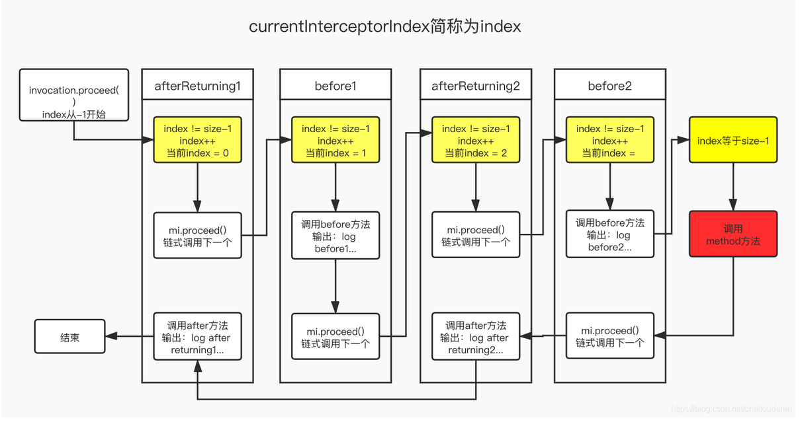

# Support for Lazy Initialization and Multiple Aspect  (By @zqczgl)

### [Lazy Initialization](#lazy-initialization)

!!! info "Code branch"
    [`lazy-init-and-multi-advice`](https://github.com/DerekYRC/mini-spring/tree/lazy-init-and-multi-advice)

In fact, not all beans are created when initializing the container. As the project grows, so do the number of beans. If every bean is loaded at startup, it would waste a lot of resources. Spring provides lazy initialization, allowing beans that are not needed immediately to be created only when accessed.

Test

lazy-test.xml

```java
// Only create the bean if it is a singleton and not lazy-loaded	
public void preInstantiateSingletons() throws BeansException {
		beanDefinitionMap.forEach((beanName, beanDefinition) -> {
			if(beanDefinition.isSingleton()&&!beanDefinition.isLazyInit()){
				getBean(beanName);
			}
		});
	}
```

```java
public class LazyInitTest {
    @Test
    public void testLazyInit() throws InterruptedException {
        ClassPathXmlApplicationContext applicationContext = new ClassPathXmlApplicationContext("classpath:lazy-test.xml");
        System.out.println(System.currentTimeMillis()+":applicationContext-over");
        TimeUnit.SECONDS.sleep(1);
        Car c= (Car) applicationContext.getBean("car");
        c.showTime(); // Show the creation time of the bean
    }
}
```

```xml
<?xml version="1.0" encoding="UTF-8"?>
<beans xmlns="http://www.springframework.org/schema/beans"
       xmlns:xsi="http://www.w3.org/2001/XMLSchema-instance"
       xsi:schemaLocation="http://www.springframework.org/schema/beans http://www.springframework.org/schema/beans/spring-beans.xsd">
    <bean id="car" class="org.springframework.test.bean.Car" lazyInit="true" init-method="init">
        <property name="brand" value="porsche"/>
    </bean>
</beans>

```

Without Lazy Initialization:

```
1671698959957:applicationContext-over
1671698959951:bean create
```

With Lazy Initialization:

```
1671699030293:applicationContext-over
1671699031328:bean create
```

You can clearly see the difference in bean creation timing with and without lazy loading.

### [Multiple Aspects for the Same Method](#multiple-aspects-for-the-same-method)

!!! info "Code branch"
    [`lazy-init-and-multi-advice`](https://github.com/DerekYRC/mini-spring/tree/lazy-init-and-multi-advice)

Although we’ve enhanced methods, it’s not perfect. Currently, the code only supports a single enhancement per method. It feels awkward not supporting multiple aspects, which is a core feature in Spring. Spring uses an interceptor chain to support multiple aspects.

#### [ProxyFactory](#ProxyFactory)

Let’s start with `ProxyFactory` to understand the proxy object creation process. We start with `ProxyFactory` because the proxy object is eventually created using its `getProxy()` method.

```java
public class ProxyFactory extends AdvisedSupport{


	public ProxyFactory() {
	}

	public Object getProxy() {
		return createAopProxy().getProxy();
	}

	private AopProxy createAopProxy() {
		if (this.isProxyTargetClass()||this.getTargetSource().getTargetClass().length==0) {
			return new CglibAopProxy(this);
		}
		return new JdkDynamicAopProxy(this);
	}
}
```

To better match Spring's implementation, we modified `ProxyFactory` to inherit from `AdvisedSupport`, just like in Spring's source code.

#### [JDK Dynamic Proxy](#jdk-dynamic-proxy)

`ProxyFactory` simply chooses between JDK dynamic proxy or CGLIB proxy. If the `proxyTargetClass` property is set or the target object has no interfaces, it uses CGLIB. Otherwise, it uses JDK dynamic proxy. Below is the implementation for JDK dynamic proxy.

```java
	public Object getProxy() {
		return Proxy.newProxyInstance(getClass().getClassLoader(), advised.getTargetSource().getTargetClass(), this);
	}

	@Override
	public Object invoke(Object proxy, Method method, Object[] args) throws Throwable {
		// Get the target object
		Object target=advised.getTargetSource().getTarget();
		Class<?> targetClass = target.getClass();
		Object retVal = null;
		// Get the interceptor chain
		List<Object> chain = this.advised.getInterceptorsAndDynamicInterceptionAdvice(method, targetClass);
		if(chain==null||chain.isEmpty()){
			return method.invoke(target, args);
		}else{
			// Wrap the interceptors in ReflectiveMethodInvocation
			MethodInvocation invocation =
					new ReflectiveMethodInvocation(proxy, target, method, args, targetClass, chain);
			// Proceed to the joinpoint through the interceptor chain.
			// Execute the interceptor chain
			retVal = invocation.proceed();
		}
		return retVal;
	}
```

JDK dynamic proxy can be broken down into three parts: getting the interceptor chain, wrapping interceptors in `ReflectiveMethodInvocation`, and executing the interceptor chain. Let's go through each part.

##### [1. Getting the Interceptor Chain](#1-getting-the-interceptor-chain)

First, all advice (enhancements) matching the current method are retrieved. By tracing `getInterceptorsAndDynamicInterceptionAdvice`, we see that Spring AOP uses caching for performance. If the interceptors for the method are already cached, they are used directly. Otherwise, the interceptors are fetched through `advisorChainFactory`. `AdvisorChainFactory` is responsible for obtaining the interceptor chain. One of its implementations is `DefaultAdvisorChainFactory`.

AdvisedSupport#getInterceptorsAndDynamicInterceptionAdvice：

```java
	public List<Object> getInterceptorsAndDynamicInterceptionAdvice(Method method, Class<?> targetClass) {
		Integer cacheKey=method.hashCode();
		List<Object> cached = this.methodCache.get(cacheKey);
		if (cached == null) {
			cached = this.advisorChainFactory.getInterceptorsAndDynamicInterceptionAdvice(
					this, method, targetClass);
			this.methodCache.put(cacheKey, cached);
		}
		return cached;
	}
```

The code is not complex. First, all `Advisor`s (aspects) are retrieved. The `pointcutAdvisor.getPointcut().getClassFilter().matches(actualClass)` checks if the current proxy object matches the `Advisor`, then `pointcutAdvisor.getPointcut().getMethodMatcher()` checks if it matches the current method being called. If both checks pass, the interceptors (enhancements) from the `Advisor` are added to the `interceptorList`.

You might wonder why we are getting `MethodInterceptor`, but `AdvisedSupport.getAdvice()` returns `Advice`. The reason is that `MethodInterceptor` implements `Interceptor`, which extends `Advice`, as per AOP Alliance interfaces.

DefultAdvisorChainFactory#getInterceptorsAndDynamicInterceptionAdvice

```java
public List<Object> getInterceptorsAndDynamicInterceptionAdvice(AdvisedSupport config, Method method, Class<?> targetClass) {
        Advisor[] advisors = config.getAdvisors().toArray(new Advisor[0]);
        List<Object> interceptorList = new ArrayList<>(advisors.length);
        Class<?> actualClass = (targetClass != null ? targetClass : method.getDeclaringClass());
        for (Advisor advisor : advisors) {
            if (advisor instanceof PointcutAdvisor) {
                // Add it conditionally.
                PointcutAdvisor pointcutAdvisor = (PointcutAdvisor) advisor;
                // Check if current Advisor applies to the current class
                if (pointcutAdvisor.getPointcut().getClassFilter().matches(actualClass)) {
                    MethodMatcher mm = pointcutAdvisor.getPointcut().getMethodMatcher();
                    boolean match;
                    // Check if Advisor applies to the current method
                    match = mm.matches(method,actualClass);
                    if (match) {
                        MethodInterceptor interceptor = (MethodInterceptor) advisor.getAdvice();
                            interceptorList.add(interceptor);
                    }
                }
            }
        }
        return interceptorList;
    }
```

##### [2. Wrapping Interceptors in ReflectiveMethodInvocation](#2-wrapping-interceptors-in-reflectivemethodinvocation)

Here, we override the `ReflectiveMethodInvocation` implementation to support multiple aspects.

```java
	public ReflectiveMethodInvocation(Object proxy,Object target, Method method, Object[] arguments,Class<?> targetClass,List<Object> chain) {
		this.proxy=proxy;
		this.target = target;
		this.method = method;
		this.arguments = arguments;
		this.targetClass=targetClass;
		this.interceptorsAndDynamicMethodMatchers=chain;
	}
```


##### [3. Executing the Interceptor Chain](#3-executing-the-interceptor-chain)

Spring ensures that multiple aspects can match the same method without causing any order issues. This is achieved by the following code.

ReflectiveMethodInvocation#proceed()

```java
	public Object proceed() throws Throwable {
		// Start with currentInterceptorIndex = -1, increment it by 1 with each proceed call
		if (this.currentInterceptorIndex == this.interceptorsAndDynamicMethodMatchers.size() - 1) {
			// Number of calls = number of interceptors
			// Invoke the actual method
			return method.invoke(this.target, this.arguments);
		}

		Object interceptorOrInterceptionAdvice =
				this.interceptorsAndDynamicMethodMatchers.get(++this.currentInterceptorIndex);
		// For normal interceptors, call their invoke method
		return ((MethodInterceptor) interceptorOrInterceptionAdvice).invoke(this);
	}
```

We see that `MethodInvocation` simply executes each interceptor in the chain and then triggers the actual method. This is a simple and efficient approach, but the issue arises when we want certain enhancements, like `AfterReturningAdvice`, to be executed after the method completes. This introduces the problem of execution order. `MethodInvocation` doesn’t handle the order, meaning `AfterReturningAdvice` could be called before `BeforeAdvice`.

So, how can we ensure the correct order?

The answer is that each interceptor is responsible for controlling the order of execution. Therefore, we need to analyze `MethodBeforeAdviceInterceptor` and `AfterReturningAdviceInterceptor`.

```java
public class MethodBeforeAdviceInterceptor implements MethodInterceptor, BeforeAdvice {

	private MethodBeforeAdvice advice;

	public MethodBeforeAdviceInterceptor() {
	}

	public MethodBeforeAdviceInterceptor(MethodBeforeAdvice advice) {
		this.advice = advice;
	}

	public void setAdvice(MethodBeforeAdvice advice) {
		this.advice = advice;
	}

	@Override
	public Object invoke(MethodInvocation mi) throws Throwable {
		this.advice.before(mi.getMethod(), mi.getArguments(), mi.getThis());
		return mi.proceed();
	}
}
```

```java
package org.springframework.aop.framework.adapter;

import org.aopalliance.intercept.MethodInterceptor;
import org.aopalliance.intercept.MethodInvocation;
import org.springframework.aop.AfterAdvice;
import org.springframework.aop.AfterReturningAdvice;

/**
 * @author zqc
 * @date 2022/12/20
 */
public class AfterReturningAdviceInterceptor implements MethodInterceptor, AfterAdvice {

    private  AfterReturningAdvice advice;

    public AfterReturningAdviceInterceptor() {
    }

    public AfterReturningAdviceInterceptor(AfterReturningAdvice advice) {
        this.advice = advice;
    }


    @Override
    public Object invoke(MethodInvocation mi) throws Throwable {
        Object retVal = mi.proceed();
        this.advice.afterReturning(retVal, mi.getMethod(), mi.getArguments(), mi.getThis());
        return retVal;
    }
}

```

After looking at the source code, it's clear that the execution order of the interceptor chain is handled in each interceptor's `invoke` method. `before` advice executes the `advice` method first and then proceeds with the chain, which is easy to understand. In contrast, `after` advice first proceeds with the chain and then calls the `advice` method, which is a recursive process. This is somewhat similar to binary tree traversal.



#### [Testing](#testing)

！！！！！！！Note that using a newer version of Java might cause errors due to conflicts with CGLIB. It's recommended to test with Java 8.

```java
public class WorldServiceImpl implements WorldService {

	private String name;

	@Override
	public void explode() {
		System.out.println("The " + name + " is going to explode");
	}

	@Override
	public String getName() {
		return name;
	}

	public void setName(String name) {
		this.name = name;
	}
}
```

Before Advice：

```java
public class WorldServiceBeforeAdvice implements MethodBeforeAdvice {

	@Override
	public void before(Method method, Object[] args, Object target) throws Throwable {
		System.out.println("BeforeAdvice: do something before the earth explodes");
	}
}
```

After Returning Advice:

```java
public class WorldServiceAfterReturnAdvice implements AfterReturningAdvice {
    @Override
    public void afterReturning(Object returnValue, Method method, Object[] args, Object target) throws Throwable {
        System.out.println("AfterAdvice: do something after the earth explodes");
    }
}
```

**Test Code:**
```java
public class ProxyFactoryTest {
    @Test
    public void testAdvisor() throws Exception {
        WorldService worldService = new WorldServiceImpl();

        // Advisor is a combination of Pointcut and Advice
        String expression = "execution(* org.springframework.test.service.WorldService.explode(..))";
        // First aspect
        AspectJExpressionPointcutAdvisor advisor = new AspectJExpressionPointcutAdvisor();
        advisor.setExpression(expression);
        MethodBeforeAdviceInterceptor methodInterceptor = new MethodBeforeAdviceInterceptor(new WorldServiceBeforeAdvice());
        advisor.setAdvice(methodInterceptor);
        // Second aspect
        AspectJExpressionPointcutAdvisor advisor1=new AspectJExpressionPointcutAdvisor();
        advisor1.setExpression(expression);
        AfterReturningAdviceInterceptor afterReturningAdviceInterceptor=new AfterReturningAdviceInterceptor(new WorldServiceAfterReturnAdvice());
        advisor1.setAdvice(afterReturningAdviceInterceptor);
        // Use ProxyFactory to create the proxy
        ProxyFactory factory = new ProxyFactory();
        TargetSource targetSource = new TargetSource(worldService);
        factory.setTargetSource(targetSource);
        factory.setProxyTargetClass(true);
        factory.addAdvisor(advisor);
        factory.addAdvisor(advisor1);
        WorldService proxy = (WorldService) factory.getProxy();
        proxy.explode();
    }
}
```

**Output:**

```
BeforeAdvice: do something before the earth explodes
The null is going to explode
AfterAdvice: do something after the earth explodes

Process finished with exit code 0
```

#### [Multi-Aspects Dynamic Proxy Integrated into Bean Lifecycle](#multi-aspects-dynamic-proxy-integrated-into-bean-lifecycle)

```java
	public void testAutoProxy() throws Exception {
		ClassPathXmlApplicationContext applicationContext = new ClassPathXmlApplicationContext("classpath:auto-proxy.xml");

		// Get proxy object
		WorldService worldService = applicationContext.getBean("worldService", WorldService.class);
		worldService.explode();
	}
```

auto-proxy.xml：

```xml
<?xml version="1.0" encoding="UTF-8"?>
<beans xmlns="http://www.springframework.org/schema/beans"
       xmlns:xsi="http://www.w3.org/2001/XMLSchema-instance"
       xmlns:context="http://www.springframework.org/schema/context"
       xsi:schemaLocation="http://www.springframework.org/schema/beans
	         http://www.springframework.org/schema/beans/spring-beans.xsd
		 http://www.springframework.org/schema/context
		 http://www.springframework.org/schema/context/spring-context-4.0.xsd">

    <bean id="worldService" class="org.springframework.test.service.WorldServiceImpl"/>

    <bean class="org.springframework.aop.framework.autoproxy.DefaultAdvisorAutoProxyCreator"/>

    <bean id="pointcutAdvisor" class="org.springframework.aop.aspectj.AspectJExpressionPointcutAdvisor">
        <property name="expression" value="execution(* org.springframework.test.service.WorldService.explode(..))"/>
        <property name="advice" ref="methodInterceptor"/>
    </bean>
    <bean id="pointcutAdvisor2" class="org.springframework.aop.aspectj.AspectJExpressionPointcutAdvisor">
        <property name="expression" value="execution(* org.springframework.test.service.WorldService.explode(..))"/>
        <property name="advice" ref="methodInterceptor2"/>
    </bean>

    <bean id="methodInterceptor" class="org.springframework.aop.framework.adapter.MethodBeforeAdviceInterceptor">
        <property name="advice" ref="beforeAdvice"/>
    </bean>
    <bean id="methodInterceptor2" class="org.springframework.aop.framework.adapter.AfterReturningAdviceInterceptor">
        <property name="advice" ref="afterAdvice"/>
    </bean>
    <bean id="afterAdvice" class="org.springframework.test.common.WorldServiceAfterReturnAdvice"/>
    <bean id="beforeAdvice" class="org.springframework.test.common.WorldServiceBeforeAdvice"/>

</beans>

```

**Output:**

```
BeforeAdvice: do something before the earth explodes
The null is going to explode
AfterAdvice: do something after the earth explodes

Process finished with exit code 0
```

With this, we have resolved the issue of multiple aspects matching the same method.
