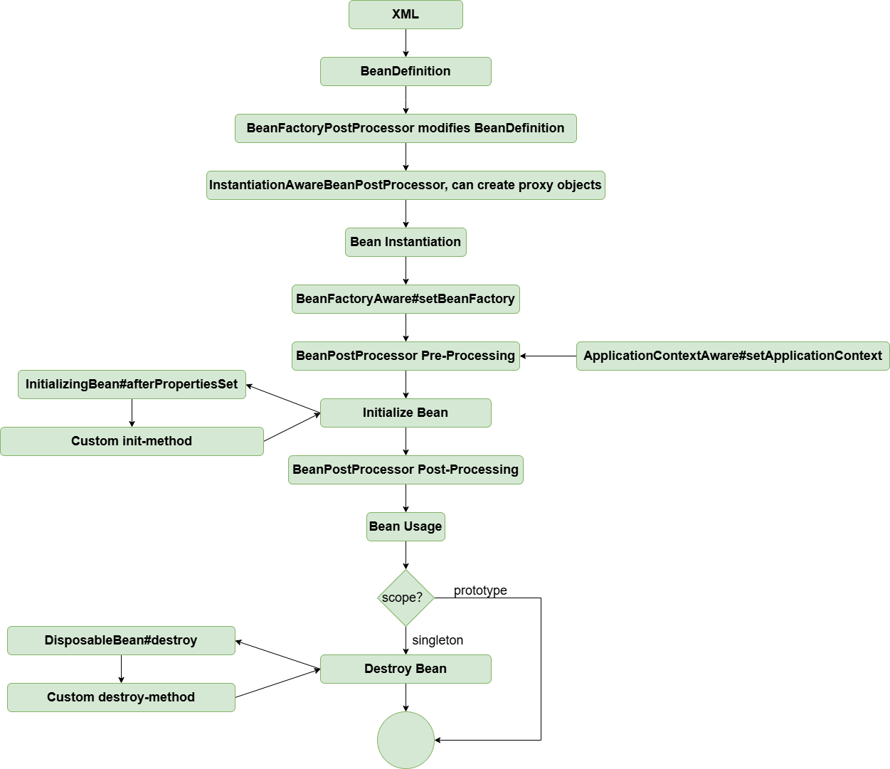

# Dynamic Proxy in Bean Lifecycle

!!! info "Code branch"
    [`auto-proxy`](https://github.com/DerekYRC/mini-spring/tree/auto-proxy)

In the bean lifecycle, the `BeanPostProcessor` phase allows modifying and replacing beans. This is where we can return a proxy object to replace the original bean. We introduce a special `BeanPostProcessor` called `InstantiationAwareBeanPostProcessor`. If this processor returns a proxy object, it short-circuits the process and prevents the original bean creation flow. See `AbstractAutowireCapableBeanFactory#resolveBeforeInstantiation` for details.

`DefaultAdvisorAutoProxyCreator` is an implementation of `InstantiationAwareBeanPostProcessor` that weaves cross-cutting logic and returns the proxy object during instantiation.

At this point, the bean lifecycle looks like this:



**Test:**
<br> auto-proxy.xml
```xml
<?xml version="1.0" encoding="UTF-8"?>
<beans xmlns="http://www.springframework.org/schema/beans"
       xmlns:xsi="http://www.w3.org/2001/XMLSchema-instance"
       xmlns:context="http://www.springframework.org/schema/context"
       xsi:schemaLocation="http://www.springframework.org/schema/beans
	         http://www.springframework.org/schema/beans/spring-beans.xsd
		 http://www.springframework.org/schema/context
		 http://www.springframework.org/schema/context/spring-context-4.0.xsd">

    <bean id="worldService" class="org.springframework.test.service.WorldServiceImpl"/>

    <bean class="org.springframework.aop.framework.autoproxy.DefaultAdvisorAutoProxyCreator"/>

    <bean id="pointcutAdvisor" class="org.springframework.aop.aspectj.AspectJExpressionPointcutAdvisor">
        <property name="expression" value="execution(* org.springframework.test.service.WorldService.explode(..))"/>
        <property name="advice" ref="methodInterceptor"/>
    </bean>


    <bean id="methodInterceptor" class="org.springframework.aop.framework.adapter.MethodBeforeAdviceInterceptor">
        <property name="advice" ref="beforeAdvice"/>
    </bean>

    <bean id="beforeAdvice" class="org.springframework.test.common.WorldServiceBeforeAdvice"/>

</beans>
```
```java
public class AutoProxyTest {

	@Test
	public void testAutoProxy() throws Exception {
		ClassPathXmlApplicationContext applicationContext = new ClassPathXmlApplicationContext("classpath:auto-proxy.xml");

		// Get the proxy object
		WorldService worldService = applicationContext.getBean("worldService", WorldService.class);
		worldService.explode();
	}
}
```
