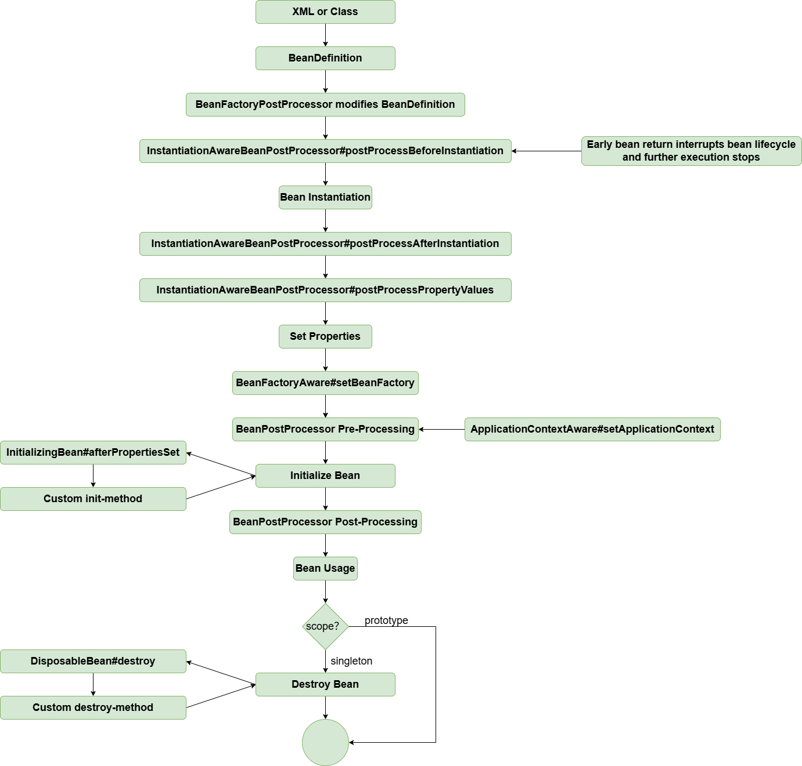

# Bug Fix: Proxy Bean Not Receiving Properties (Discovered and Fixed by @kerwin89)

!!! info "Code branch"
    [`populate-proxy-bean-with-property-values`](https://github.com/DerekYRC/mini-spring/tree/populate-proxy-bean-with-property-values)

### Issue:
The proxy bean was not receiving its properties.

### Cause:
The weaving logic in `InstantiationAwareBeanPostProcessor#postProcessBeforeInstantiation` was executed, and if it returned a non-null value, it caused a "short-circuit," skipping the property setting logic. Therefore, if the method returned a proxy bean, its properties were not set.

### Solution:
To align with Spring's behavior, the weaving logic was moved to `BeanPostProcessor#postProcessAfterInitialization`. Specifically, the content of `DefaultAdvisorAutoProxyCreator#postProcessBeforeInstantiation` was moved to `DefaultAdvisorAutoProxyCreator#postProcessAfterInitialization`.

Additionally, Spring’s extension mechanism was enhanced by adding `postProcessAfterInstantiation` to `InstantiationAwareBeanPostProcessor`, which executes after bean instantiation but before property setting.

With this change, the bean lifecycle is now more complete, as shown below:



**Test:**
<br> populate-proxy-bean-with-property-values.xml
```xml
<?xml version="1.0" encoding="UTF-8"?>
<beans xmlns="http://www.springframework.org/schema/beans"
       xmlns:xsi="http://www.w3.org/2001/XMLSchema-instance"
       xmlns:context="http://www.springframework.org/schema/context"
       xsi:schemaLocation="http://www.springframework.org/schema/beans
	         http://www.springframework.org/schema/beans/spring-beans.xsd
		 http://www.springframework.org/schema/context
		 http://www.springframework.org/schema/context/spring-context-4.0.xsd">

    <bean id="worldService" class="org.springframework.test.service.WorldServiceImpl">
        <property name="name" value="earth"/>
    </bean>

    <bean class="org.springframework.aop.framework.autoproxy.DefaultAdvisorAutoProxyCreator"/>

    <bean id="pointcutAdvisor" class="org.springframework.aop.aspectj.AspectJExpressionPointcutAdvisor">
        <property name="expression" value="execution(* org.springframework.test.service.WorldService.explode(..))"/>
        <property name="advice" ref="methodInterceptor"/>
    </bean>


    <bean id="methodInterceptor" class="org.springframework.aop.framework.adapter.MethodBeforeAdviceInterceptor">
        <property name="advice" ref="beforeAdvice"/>
    </bean>

    <bean id="beforeAdvice" class="org.springframework.test.common.WorldServiceBeforeAdvice"/>

</beans>
```

```java
public class WorldServiceImpl implements WorldService {

	private String name;

	@Override
	public void explode() {
		System.out.println("The " + name + " is going to explode");
	}

	// setter and getter
}
```

```java
public class AutoProxyTest {

	@Test
	public void testPopulateProxyBeanWithPropertyValues() throws Exception {
		ClassPathXmlApplicationContext applicationContext = new ClassPathXmlApplicationContext("classpath:populate-proxy-bean-with-property-values.xml");

		// Get the proxy bean
		WorldService worldService = applicationContext.getBean("worldService", WorldService.class);
		worldService.explode();
		assertThat(worldService.getName()).isEqualTo("earth");
	}
}
```
