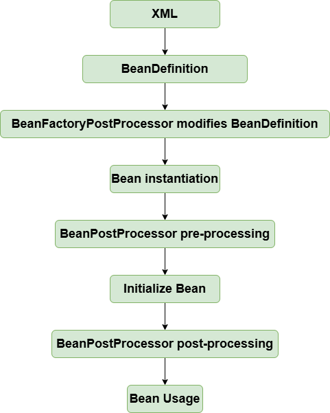

# ApplicationContext

!!! info "Code branch"
    [`application-context`](https://github.com/DerekYRC/mini-spring/tree/application-context)

`ApplicationContext` is an advanced IOC container in Spring, compared to `BeanFactory`. In addition to all the features of `BeanFactory`, it also supports:
- Automatic detection of special beans like `BeanFactoryPostProcessor` and `BeanPostProcessor` (as discussed in the previous section)
- Resource loading
- Container events and listeners
- Internationalization support
- Automatic initialization of singleton beans

While `BeanFactory` is the infrastructure for Spring, `ApplicationContext` is designed for users of Spring applications.

For the implementation details, check the `AbstractApplicationContext#refresh` method. Note that `BeanFactoryPostProcessor` and `BeanPostProcessor` are automatically recognized, so you no longer need to manually add them to the container in the XML file as shown earlier.

The bean lifecycle looks like this:

**Test:** See `ApplicationContextTest`
