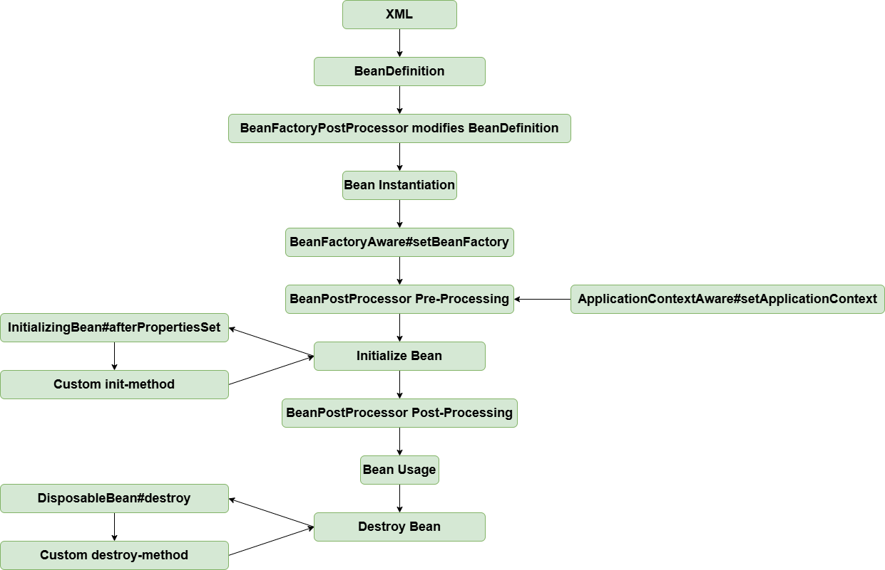

# Aware Interface

!!! info "Code branch"
    [`aware-interface`](https://github.com/DerekYRC/mini-spring/tree/aware-interface)

`Aware` refers to awareness. The `Aware` interface is a marker interface that allows implementing classes to be aware of container-related objects. Common `Aware` interfaces include `BeanFactoryAware` and `ApplicationContextAware`, which allow classes to be aware of their `BeanFactory` and `ApplicationContext`, respectively.

To make a class aware of its `BeanFactory`, it implements the `BeanFactoryAware` interface. This is done easily in `AbstractAutowireCapableBeanFactory#initializeBean` (the first three lines).

To make a class aware of its `ApplicationContext`, the `ApplicationContextAware` interface is used via a `BeanPostProcessor`. After the bean is instantiated, it goes through the pre- and post-processing steps of `BeanPostProcessor`. We define a `BeanPostProcessor` implementation called `ApplicationContextAwareProcessor`, which is added to the `BeanFactory` in the `AbstractApplicationContext#refresh` method. The pre-processing step sets the `ApplicationContext` for the bean.

We now use `dom4j` to parse the XML file.

At this point, the bean lifecycle looks like this:



**Test:** 
<br> spring.xml
```xml
<?xml version="1.0" encoding="UTF-8"?>
<beans xmlns="http://www.springframework.org/schema/beans"
       xmlns:xsi="http://www.w3.org/2001/XMLSchema-instance"
       xmlns:context="http://www.springframework.org/schema/context"
       xsi:schemaLocation="http://www.springframework.org/schema/beans
	         http://www.springframework.org/schema/beans/spring-beans.xsd
		 http://www.springframework.org/schema/context
		 http://www.springframework.org/schema/context/spring-context-4.0.xsd">

    <bean id="helloService" class="org.springframework.test.service.HelloService"/>

</beans>
```

```java
public class HelloService implements ApplicationContextAware, BeanFactoryAware {

	private ApplicationContext applicationContext;

	private BeanFactory beanFactory;

	@Override
	public void setBeanFactory(BeanFactory beanFactory) throws BeansException {
		this.beanFactory = beanFactory;
	}

	@Override
	public void setApplicationContext(ApplicationContext applicationContext) throws BeansException {
		this.applicationContext = applicationContext;
	}

	public ApplicationContext getApplicationContext() {
		return applicationContext;
	}

	public BeanFactory getBeanFactory() {
		return beanFactory;
	}
}
```

```java
public class AwareInterfaceTest {

	@Test
	public void test() throws Exception {
		ClassPathXmlApplicationContext applicationContext = new ClassPathXmlApplicationContext("classpath:spring.xml");
		HelloService helloService = applicationContext.getBean("helloService", HelloService.class);
		assertThat(helloService.getApplicationContext()).isNotNull();
		assertThat(helloService.getBeanFactory()).isNotNull();
	}
}
```
