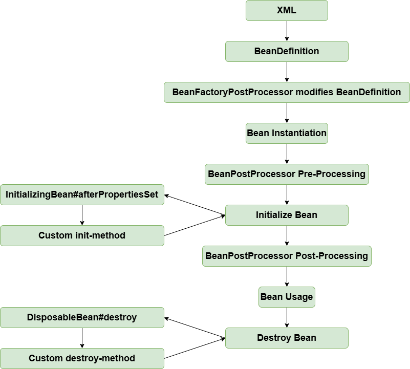

# Bean Initialization and Destruction Methods

!!! info "Code branch"
    [`init-and-destroy-method`](https://github.com/DerekYRC/mini-spring/tree/init-and-destroy-method)

In Spring, there are three ways to define initialization and destruction methods for beans:
- Specify `init-method` and `destroy-method` in the XML configuration
- Implement `InitializingBean` and `DisposableBean` interfaces
- Use `@PostConstruct` and `@PreDestroy` annotations

The third method is implemented via `BeanPostProcessor` and will be covered in the advanced section. This section only covers the first two methods.

For the first method (XML configuration), `initMethodName` and `destroyMethodName` properties are added to `BeanDefinition`.

The initialization method is executed in `AbstractAutowireCapableBeanFactory#invokeInitMethods`. Beans with destruction methods are registered in `disposableBeans` in `DefaultSingletonBeanRegistry`, and are registered for destruction in `AbstractAutowireCapableBeanFactory#registerDisposableBeanIfNecessary`.

To ensure destruction methods run before the VM shuts down, a shutdown hook is registered in the JVM via `AbstractApplicationContext#registerShutdownHook` (this must be manually called in non-web applications). Alternatively, you can call `ApplicationContext#close` to close the container.

At this point, the bean lifecycle looks like this:



**Test:** 
<br> init-and-destroy-method.xml
```xml
<?xml version="1.0" encoding="UTF-8"?>
<beans xmlns="http://www.springframework.org/schema/beans"
       xmlns:xsi="http://www.w3.org/2001/XMLSchema-instance"
       xmlns:context="http://www.springframework.org/schema/context"
       xsi:schemaLocation="http://www.springframework.org/schema/beans
	         http://www.springframework.org/schema/beans/spring-beans.xsd
		 http://www.springframework.org/schema/context
		 http://www.springframework.org/schema/context/spring-context-4.0.xsd">

    <bean id="person" class="org.springframework.test.bean.Person" init-method="customInitMethod" destroy-method="customDestroyMethod">
        <property name="name" value="derek"/>
        <property name="car" ref="car"/>
    </bean>

    <bean id="car" class="org.springframework.test.bean.Car">
        <property name="brand" value="porsche"/>
    </bean>

</beans>
```

```java
public class Person implements InitializingBean, DisposableBean {

	private String name;

	private int age;

	private Car car;

	public void customInitMethod() {
		System.out.println("I was born in the method named customInitMethod");
	}

	public void customDestroyMethod() {
		System.out.println("I died in the method named customDestroyMethod");
	}

	@Override
	public void afterPropertiesSet() throws Exception {
		System.out.println("I was born in the method named afterPropertiesSet");
	}

	@Override
	public void destroy() throws Exception {
		System.out.println("I died in the method named destroy");
	}

    //setter and getter
}
```

```java
public class InitAndDestoryMethodTest {

	@Test
	public void testInitAndDestroyMethod() throws Exception {
		ClassPathXmlApplicationContext applicationContext = new ClassPathXmlApplicationContext("classpath:init-and-destroy-method.xml");
		applicationContext.registerShutdownHook();  // Alternatively, manually close using applicationContext.close();
	}
}
```
