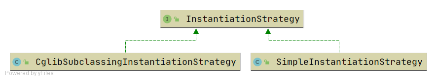

# Bean Instantiation Strategy

!!! info "Code branch"
    [`instantiation-strategy`](https://github.com/DerekYRC/mini-spring/tree/instantiation-strategy)

Currently, beans are instantiated using `beanClass.newInstance()` in `AbstractAutowireCapableBeanFactory.doCreateBean`, which only works for no-argument constructors.

To provide more flexible bean instantiation, an `InstantiationStrategy` interface is introduced, with two implementations:
- `SimpleInstantiationStrategy`: Uses constructors to instantiate beans.
- `CglibSubclassingInstantiationStrategy`: Uses CGLIB to generate subclass proxies.
