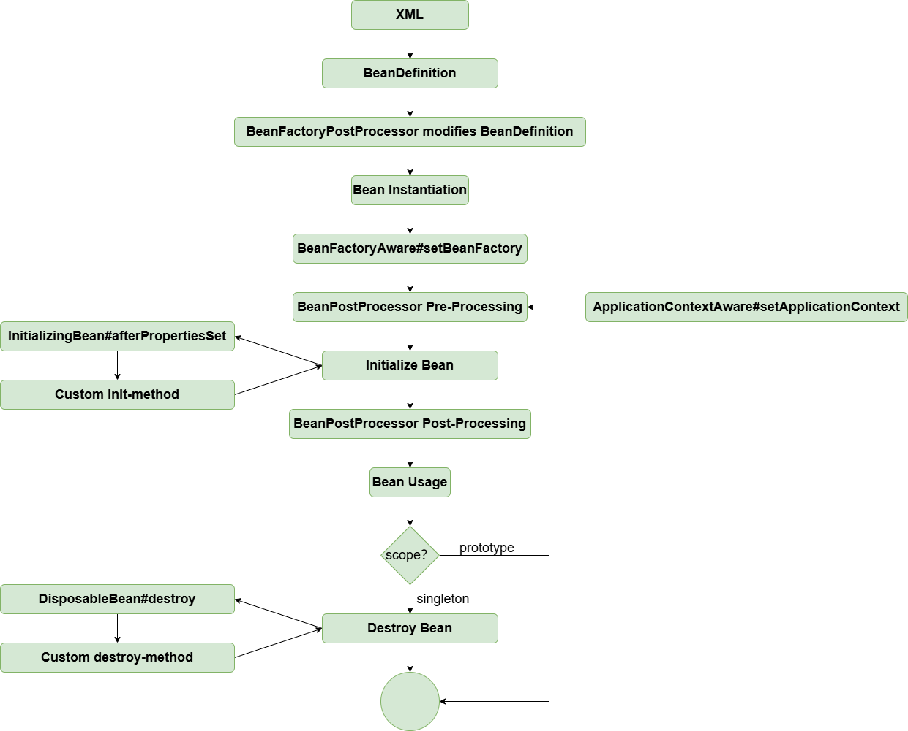

# Bean Scope - Adding Prototype Support

!!! info "Code branch"
    [`prototype-bean`](https://github.com/DerekYRC/mini-spring/tree/prototype-bean)

For a `prototype` scoped bean, every time it's requested from the container, a new instance is created. We add a `scope` field in `BeanDefinition` to describe the bean's scope. When creating a prototype bean (`AbstractAutowireCapableBeanFactory#doCreateBean`), it is **not** added to the `singletonObjects` map. 

Prototype beans do not execute their destruction methods, as seen in `AbstractAutowireCapableBeanFactory#registerDisposableBeanIfNecessary`.

At this point, the bean lifecycle looks like this:



**Test:** 
<br> prototype-bean.xml
```xml
<?xml version="1.0" encoding="UTF-8"?>
<beans xmlns="http://www.springframework.org/schema/beans"
       xmlns:xsi="http://www.w3.org/2001/XMLSchema-instance"
       xmlns:context="http://www.springframework.org/schema/context"
       xsi:schemaLocation="http://www.springframework.org/schema/beans
	         http://www.springframework.org/schema/beans/spring-beans.xsd
		 http://www.springframework.org/schema/context
		 http://www.springframework.org/schema/context/spring-context-4.0.xsd">

    <bean id="car" class="org.springframework.test.bean.Car" scope="prototype">
        <property name="brand" value="porsche"/>
    </bean>

</beans>
```

```java
public class PrototypeBeanTest {

	@Test
	public void testPrototype() throws Exception {
		ClassPathXmlApplicationContext applicationContext = new ClassPathXmlApplicationContext("classpath:prototype-bean.xml");

		Car car1 = applicationContext.getBean("car", Car.class);
		Car car2 = applicationContext.getBean("car", Car.class);
		assertThat(car1 != car2).isTrue();
	}
}
```
