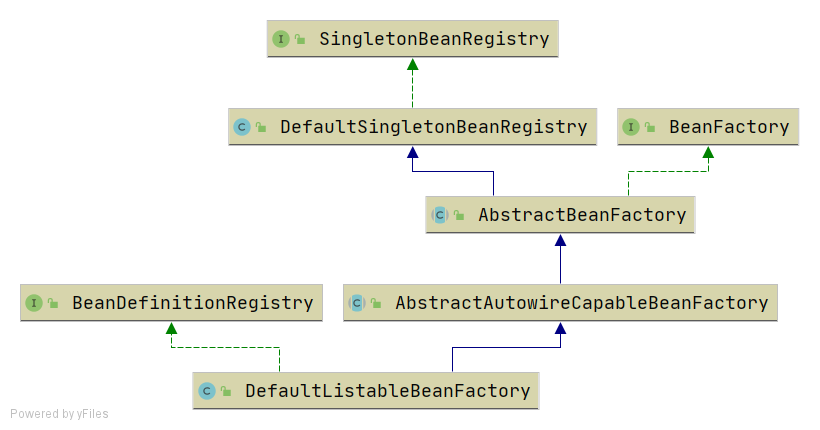

# BeanDefinition and BeanDefinitionRegistry

!!! info "Code branch"
    [`bean-definition-and-bean-definition-registry`](https://github.com/DerekYRC/mini-spring/tree/bean-definition-and-bean-definition-registry)

New classes added:
- `BeanDefinition`: Defines the bean metadata such as class type, constructor arguments, and property values. For simplicity, this version only contains the class type.
- `BeanDefinitionRegistry`: Interface for registering `BeanDefinition` instances.
- `SingletonBeanRegistry` and its implementation `DefaultSingletonBeanRegistry`: Defines methods for adding and retrieving singleton beans.

The bean container implements both `BeanDefinitionRegistry` and `SingletonBeanRegistry`, giving it the ability to register `BeanDefinition` and manage singleton beans. Beans are only instantiated when they are used.



**Test:**
```java
public class BeanDefinitionAndBeanDefinitionRegistryTest {

	@Test
	public void testBeanFactory() throws Exception {
		DefaultListableBeanFactory beanFactory = new DefaultListableBeanFactory();
		BeanDefinition beanDefinition = new BeanDefinition(HelloService.class);
		beanFactory.registerBeanDefinition("helloService", beanDefinition);

		HelloService helloService = (HelloService) beanFactory.getBean("helloService");
		helloService.sayHello();
	}
}

class HelloService {
	public String sayHello() {
		System.out.println("hello");
		return "hello";
	}
}
```
