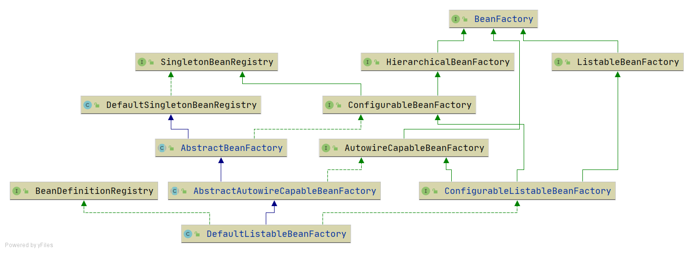

# Defining Beans in XML

!!! info "Code branch"
    [`xml-file-define-bean`](https://github.com/DerekYRC/mini-spring/tree/xml-file-define-bean)

With the `ResourceLoader`, we can declaratively define bean information in XML configuration files. The resource loader reads the XML file, parses the bean information, and registers the `BeanDefinition` into the container.

`BeanDefinitionReader` is an abstraction for reading bean definition information, and `XmlBeanDefinitionReader` is the implementation for reading from XML files. The `BeanDefinitionReader` needs the ability to access resources, and after reading the bean definitions, it registers them into the container. Thus, the abstract implementation `AbstractBeanDefinitionReader` has both `ResourceLoader` and `BeanDefinitionRegistry` properties.

Since content read from the XML file is a `String`, only properties of type `String` or references to other beans are supported. Type converters for type conversion will be covered later.

To align with Spring's `BeanFactory` inheritance structure, slight adjustments were made to the inheritance hierarchy for `BeanFactory`.



**Test:**  
Bean definition file `spring.xml`
```xml
<?xml version="1.0" encoding="UTF-8"?>
<beans xmlns="http://www.springframework.org/schema/beans"
       xmlns:xsi="http://www.w3.org/2001/XMLSchema-instance"
       xmlns:context="http://www.springframework.org/schema/context"
       xsi:schemaLocation="http://www.springframework.org/schema/beans
	         http://www.springframework.org/schema/beans/spring-beans.xsd
		 http://www.springframework.org/schema/context
		 http://www.springframework.org/schema/context/spring-context-4.0.xsd">

    <bean id="person" class="org.springframework.test.bean.Person">
        <property name="name" value="derek"/>
        <property name="car" ref="car"/>
    </bean>

    <bean id="car" class="org.springframework.test.bean.Car">
        <property name="brand" value="porsche"/>
    </bean>

</beans>
```

```java
public class XmlFileDefineBeanTest {

	@Test
	public void testXmlFile() throws Exception {
		DefaultListableBeanFactory beanFactory = new DefaultListableBeanFactory();
		XmlBeanDefinitionReader beanDefinitionReader = new XmlBeanDefinitionReader(beanFactory);
		beanDefinitionReader.loadBeanDefinitions("classpath:spring.xml");

		Person person = (Person) beanFactory.getBean("person");
		System.out.println(person);
		assertThat(person.getName()).isEqualTo("derek");
		assertThat(person.getCar().getBrand()).isEqualTo("porsche");

		Car car = (Car) beanFactory.getBean("car");
		System.out.println(car);
		assertThat(car.getBrand()).isEqualTo("porsche");
	}
}
```
