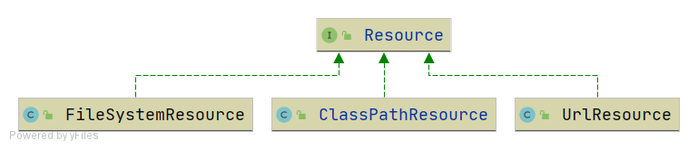

# Resources and Resource Loaders

!!! info "Code branch"
    [`resource-and-resource-loader`](https://github.com/DerekYRC/mini-spring/tree/resource-and-resource-loader)

`Resource` is an abstraction for resources and provides an access interface. Three implementations are created:



- `FileSystemResource`: Implementation for file system resources.
- `ClassPathResource`: Implementation for classpath resources.
- `UrlResource`: Implementation for resources located via `java.net.URL`.

`ResourceLoader` is an abstraction for resource lookup strategies, with `DefaultResourceLoader` as the default implementation.

**Test:**
```java
public class ResourceAndResourceLoaderTest {

	@Test
	public void testResourceLoader() throws Exception {
		DefaultResourceLoader resourceLoader = new DefaultResourceLoader();

		// Load classpath resource
		Resource resource = resourceLoader.getResource("classpath:hello.txt");
		InputStream inputStream = resource.getInputStream();
		String content = IoUtil.readUtf8(inputStream);
		System.out.println(content);
		assertThat(content).isEqualTo("hello world");

		// Load file system resource
		resource = resourceLoader.getResource("src/test/resources/hello.txt");
		assertThat(resource instanceof FileSystemResource).isTrue();
		inputStream = resource.getInputStream();
		content = IoUtil.readUtf8(inputStream);
		System.out.println(content);
		assertThat(content).isEqualTo("hello world");

		// Load URL resource
		resource = resourceLoader.getResource("https://www.baidu.com");
		assertThat(resource instanceof UrlResource).isTrue();
		inputStream = resource.getInputStream();
		content = IoUtil.readUtf8(inputStream);
		System.out.println(content);
	}
}
```
